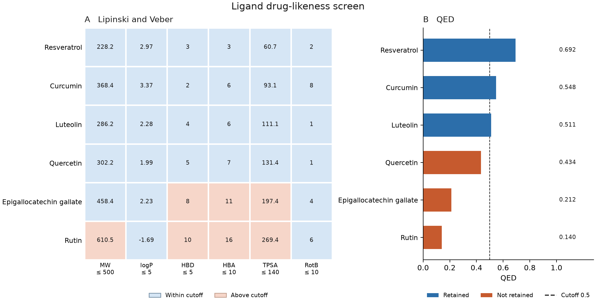

# Drug-Likeness Screening for a Small Natural-Product Set

[](LICENSE)

[](https://github.com/Ishitta-Sarkar/computational-drug-discovery-platform/actions/workflows/ci.yml)

A ligand drug-likeness screening workflow for six natural products. Structures are fetched from PubChem by CID, RDKit calculates the descriptors, and Lipinski's rule of five, Veber's rules and a stated QED cutoff decide which ligands are retained.

> **Scope.** Learning project, six ligands. Every number in the results table is computed by `main.py` from the retrieved SMILES. There is no docking score: a score belongs to one ligand–target calculation, and this repository does not dock. A separate docking exercise is [covid-mpro-phytochemical-docking](https://github.com/Ishitta-Sarkar/covid-mpro-phytochemical-docking). Affinity numbers from that repository are not reused here.

## Question

Which of these six compounds pass oral drug-likeness filters when the descriptors come from the PubChem structure?

## Data

`data/ligands.csv` stores a name and a PubChem CID. `main.py` requests the SMILES string and reference properties from [PubChem PUG REST](https://pubchem.ncbi.nlm.nih.gov/rest/pug).

| Ligand | PubChem CID |
| --- | --- |
| Quercetin | [5280343](https://pubchem.ncbi.nlm.nih.gov/compound/5280343) |
| Curcumin | [969516](https://pubchem.ncbi.nlm.nih.gov/compound/969516) |
| Resveratrol | [445154](https://pubchem.ncbi.nlm.nih.gov/compound/445154) |
| Epigallocatechin gallate | [65064](https://pubchem.ncbi.nlm.nih.gov/compound/65064) |
| Luteolin | [5280445](https://pubchem.ncbi.nlm.nih.gov/compound/5280445) |
| Rutin | [5280805](https://pubchem.ncbi.nlm.nih.gov/compound/5280805) |

The committed run used the structures PubChem returned on 2026-11-24 (`results/pubchem_retrieval.json`, retrieved 2026-11-24T16:14:46Z). Curcumin is the β-diketone tautomer stored for CID 969516. Resveratrol is the (E) isomer. Epigallocatechin gallate is the (2R,3R) stereoisomer. Rutin is quercetin-3-O-rutinoside.

Kim S, Chen J, Cheng T, Gindulyte A, He J, He S, Li Q, Shoemaker BA, Thiessen PA, Yu B, Zaslavsky L, Zhang J, Bolton EE. PubChem 2023 update. Nucleic Acids Res. 2023;51(D1):D1373–D1380. doi:[10.1093/nar/gkac956](https://doi.org/10.1093/nar/gkac956).

## Methods

Descriptors are calculated with RDKit 2026.09.2. The SMILES string is the only structural input. PubChem's own XLogP, TPSA, hydrogen-bond counts and rotatable-bond counts are saved next to the RDKit values and are not used to pass or fail a ligand.

| Property | Calculation | Cutoff |
| --- | --- | --- |
| Molecular weight | `Descriptors.MolWt` (average mass) | ≤ 500 |
| logP | `Crippen.MolLogP` | ≤ 5 |
| Hydrogen-bond donors | `Lipinski.NumHDonors` | ≤ 5 |
| Hydrogen-bond acceptors | `Lipinski.NumHAcceptors` | ≤ 10 |
| TPSA | `Descriptors.TPSA` | ≤ 140 Ų |
| Rotatable bonds | Veber count in `veber_rotatable_bond_count` | ≤ 10 |
| QED | `QED.qed` | ≥ 0.5 |

Lipinski pass means zero violations. Veber pass means zero violations. A ligand is retained only when all three filters pass.

The QED line at 0.5 is a cutoff chosen for this screen. Bickerton and colleagues published QED as a continuous desirability score and did not define that line. The rule of five is often applied with one violation allowed. This workflow requires zero Lipinski violations and still prints the violation list.

Rotatable bonds follow Veber et al. (2002): single bonds outside rings between non-terminal heavy atoms, amide C–N bonds excluded, esters counted. `Lipinski.NumRotatableBonds` uses RDKit's strict count, which also drops esters. That strict count is what QED uses internally. It is not the Veber column. On this set the Veber count matches PubChem, including 4 rotatable bonds for epigallocatechin gallate. The strict count would be 3, because of the gallate ester. Both are below 10, so the Veber call does not depend on that choice here.

- Lipinski CA, Lombardo F, Dominy BW, Feeney PJ. Experimental and computational approaches to estimate solubility and permeability in drug discovery and development settings. Adv Drug Deliv Rev. 1997;23(1–3):3–25. doi:[10.1016/S0169-409X(96)00423-1](https://doi.org/10.1016/S0169-409X(96)00423-1). Update: Adv Drug Deliv Rev. 2001;46(1–3):3–26. doi:[10.1016/S0169-409X(00)00129-0](https://doi.org/10.1016/S0169-409X(00)00129-0).
- Veber DF, Johnson SR, Cheng HY, Smith BR, Ward KW, Kopple KD. Molecular properties that influence the oral bioavailability of drug candidates. J Med Chem. 2002;45(12):2615–2623. doi:[10.1021/jm020017n](https://doi.org/10.1021/jm020017n).
- Bickerton GR, Paolini GV, Besnard J, Muresan S, Hopkins AL. Quantifying the chemical beauty of drugs. Nat Chem. 2012;4(2):90–98. doi:[10.1038/nchem.1243](https://doi.org/10.1038/nchem.1243).
- RDKit: Open-source cheminformatics. https://www.rdkit.org

## Quickstart

```bash
python -m venv .venv
source .venv/bin/activate
pip install -r requirements.txt
python main.py
python -m pytest
```

`python main.py` needs network access to PubChem. It rewrites `results/pubchem_retrieval.json`, `results/druglikeness_table.csv`, `results/summary.txt` and `results/druglikeness_screen.png`.

Versions are pinned in `requirements.txt`. GitHub Actions installs that file on Python 3.12, runs ruff and pytest, then runs `main.py`.

## Results



*Figure. Left: RDKit values for the Lipinski and Veber rules (MW and TPSA rounded for the cells). Blue cells are within the cutoff. Orange cells are above it. Right: QED. The dashed line is the cutoff of 0.5 chosen for this workflow. Blue bars pass Lipinski, Veber and that QED cutoff. Orange bars do not. Ligands are ordered by QED. The table below is the source for the reported numbers.*

| Ligand | MW | Crippen logP | HBD | HBA | TPSA | RotB | QED | Lipinski | Veber | QED ≥ 0.5 | Retained |
| --- | ---: | ---: | ---: | ---: | ---: | ---: | ---: | --- | --- | --- | --- |
| Quercetin | 302.24 | 1.99 | 5 | 7 | 131.36 | 1 | 0.434 | pass | pass | fail | no |
| Curcumin | 368.39 | 3.37 | 2 | 6 | 93.06 | 8 | 0.548 | pass | pass | pass | yes |
| Resveratrol | 228.25 | 2.97 | 3 | 3 | 60.69 | 2 | 0.692 | pass | pass | pass | yes |
| Epigallocatechin gallate | 458.38 | 2.23 | 8 | 11 | 197.37 | 4 | 0.212 | fail | fail | fail | no |
| Luteolin | 286.24 | 2.28 | 4 | 6 | 111.13 | 1 | 0.511 | pass | pass | pass | yes |
| Rutin | 610.52 | -1.69 | 10 | 16 | 269.43 | 6 | 0.140 | fail | fail | fail | no |

Retained: curcumin, resveratrol and luteolin.

### Rutin, and where the filters disagree

Rutin fails Lipinski. Quercetin, the same flavonol without the sugar, passes Lipinski and Veber.

Rutin (CID 5280805) is quercetin-3-O-rutinoside. RDKit gives molecular weight 610.52 (cutoff 500), 10 hydrogen-bond donors (cutoff 5) and 16 acceptors (cutoff 10). Crippen logP is -1.69, which is inside the Lipinski logP limit, so the failures are size and hydrogen bonding. TPSA is 269.43, so Veber fails on polar surface area, while rotatable bonds (6) stay within the limit of 10. QED is 0.140, compared with 0.434 for quercetin.

The disaccharide is what crosses those cutoffs. The rules compare the intact structure with ranges associated with oral drugs. They do not measure binding, and they do not say whether the sugar is cleaved before absorption. A glycoside can be worth studying and still be a poor match to Lipinski's oral ranges.

No ligand here has exactly one Lipinski violation, so allowing one violation, which is a common way to apply the rule of five, would not change who passes Lipinski. Rutin has three violations. Epigallocatechin gallate has two (8 donors, 11 acceptors) and also fails Veber (TPSA 197.37). It is not a glycoside. QED is 0.212. A familiar natural product is not retained by default.

Quercetin is the awkward middle case. It passes Lipinski and Veber and still misses the QED cutoff used here (0.434), so it is not retained. Luteolin, which has no 3-hydroxy group, has QED 0.511 and is retained. Curcumin has QED 0.548. Those three scores sit next to a line this workflow chose. They are not a sharp division into drugs and non-drugs.

PubChem's XLogP, TPSA, hydrogen-bond counts and rotatable-bond counts, scored with the same cutoffs, give the same Lipinski call and the same Veber call for all six ligands. Donor and acceptor counts match PubChem exactly, and so do rotatable-bond counts. The largest Crippen-versus-XLogP gap is 1.03 for epigallocatechin gallate (2.23 versus 1.20). The largest TPSA gap is 4.36 Ų for quercetin (131.36 versus 127). The largest average-mass gap is 0.025 Da, also for epigallocatechin gallate (458.375 versus 458.400). None of those reference numbers enters the decision.

`results/summary.txt` is the same text `main.py` prints.

## Limitations

- The six names are the previous learning set. This is not a diversity set and not a list of discovered hits.
- The filters estimate resemblance to oral drugs. They are not activity, safety or measured bioavailability.
- Lipinski's 1997 analysis set aside antibiotics, antifungals, vitamins and cardiac glycosides, many of which are taken up by transporters. A glycosylated flavonoid falling outside the cutoffs fits that scope. It is not, by itself, a reason to drop the compound from biological study.
- The QED cutoff of 0.5 is a choice of this screen. Quercetin, luteolin and curcumin lie close to it.
- Curcumin is screened as the diketone tautomer PubChem stores. Other tautomers and protonation states were not enumerated.
- An earlier table ranked these names by one `docking_score` and printed rutin first. The column had no target. It included -9.0 for rutin, -8.1 for quercetin and -7.8 for curcumin. The quercetin and curcumin figures are the same ones listed as main-protease affinities in [covid-mpro-phytochemical-docking](https://github.com/Ishitta-Sarkar/covid-mpro-phytochemical-docking). They were removed. They were not reattached to ACE2, PPARG, APP or SNCA. Those four names used to sit in `data/target_protein.csv` without structures or poses, and that file has been removed.
- There is no PAINS filter and no docking calculation.

## Layout

```text
data/ligands.csv            names and PubChem CIDs
src/druglikeness/           fetch, RDKit descriptors, filters, summary, figure
main.py                     writes results/
results/                    retrieval JSON, table, summary, figure
tests/                      pytest
.github/workflows/ci.yml    ruff, pytest, and a live run
requirements.txt            pinned packages
CITATION.cff
CHANGELOG.md
```

## Citation

Sarkar, I. (2026). Ligand drug-likeness screening (v0.2.0). https://github.com/Ishitta-Sarkar/computational-drug-discovery-platform

Machine-readable citation: [CITATION.cff](CITATION.cff). ORCID: [https://orcid.org/0009-0008-1028-6010](https://orcid.org/0009-0008-1028-6010).

## Author

**Ishitta Sarkar**

- M.Tech in Bioinformatics (in progress, expected 2028)
- B.Tech Biotechnology (Honours), Dr. A.P.J. Abdul Kalam Technical University, 2022–2026

## License

MIT. See [LICENSE](LICENSE).
