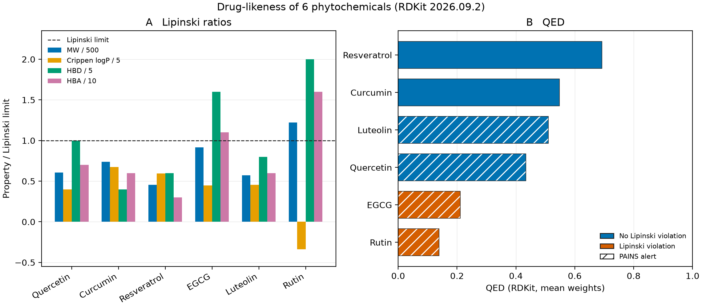

# Ligand drug-likeness and pre-docking screen

[](LICENSE)

[](https://github.com/Ishitta-Sarkar/computational-drug-discovery-platform/actions/workflows/ci.yml)

Learning project. Six plant-derived compounds are fetched from PubChem by CID and screened with RDKit for Lipinski's rule of five, Veber's oral-bioavailability criteria, quantitative estimate of drug-likeness (QED), and PAINS alerts.

This is a pre-docking filter for a small set. It calculates physicochemical descriptors from structure. It does not dock a ligand into a protein, and it does not report a binding score.

The repository is still named `computational-drug-discovery-platform`. That name is too broad for what the code does. A better name is `ligand-druglikeness-screen`.

## Question

For this set of six natural products, which molecules pass common oral drug-likeness filters when the descriptors are computed from PubChem structures, and how does rutin compare with quercetin, its aglycone?

## Data

The ligand list is `data/ligands.csv`. It stores a name, a PubChem CID and a chemical class. It does not store descriptors or scores.

`scripts/fetch_pubchem.py` requests those CIDs from PubChem PUG REST and writes `data/pubchem_compounds.json`. The cache used for the numbers below was retrieved on **2026-11-24**. The request URL is recorded in the cache and in `results/run_info.json`. The file is small, so it is committed. A fresh clone can rerun the screen without network access. Run the script again to refresh the structures.

| Compound | Class | PubChem CID |
|---|---|---|
| Quercetin | flavonol | [5280343](https://pubchem.ncbi.nlm.nih.gov/compound/5280343) |
| Curcumin | diarylheptanoid | [969516](https://pubchem.ncbi.nlm.nih.gov/compound/969516) |
| Resveratrol | stilbene, (E) isomer | [445154](https://pubchem.ncbi.nlm.nih.gov/compound/445154) |
| Epigallocatechin gallate | flavan-3-ol gallate | [65064](https://pubchem.ncbi.nlm.nih.gov/compound/65064) |
| Luteolin | flavone | [5280445](https://pubchem.ncbi.nlm.nih.gov/compound/5280445) |
| Rutin | flavonol glycoside (quercetin 3-O-rutinoside) | [5280805](https://pubchem.ncbi.nlm.nih.gov/compound/5280805) |

The screen parses the isomeric SMILES (`SMILES` in the PUG REST response) and checks that the InChIKey RDKit computes matches the InChIKey PubChem returned. Those keys are:

| Compound | InChIKey |
|---|---|
| Quercetin | `REFJWTPEDVJJIY-UHFFFAOYSA-N` |
| Curcumin | `VFLDPWHFBUODDF-FCXRPNKRSA-N` |
| Resveratrol | `LUKBXSAWLPMMSZ-OWOJBTEDSA-N` |
| Epigallocatechin gallate | `WMBWREPUVVBILR-WIYYLYMNSA-N` |
| Luteolin | `IQPNAANSBPBGFQ-UHFFFAOYSA-N` |
| Rutin | `IKGXIBQEEMLURG-NVPNHPEKSA-N` |

## Methods

Software: Python 3.12 and RDKit 2026.09.2 (`rdkit==2026.9.2` in `requirements.txt`). The same versions are recorded in `results/run_info.json`.

For each molecule, RDKit computes:

| Property | RDKit call | Used for |
|---|---|---|
| Average molecular weight | `Descriptors.MolWt` | Lipinski |
| Wildman–Crippen logP | `Descriptors.MolLogP` | Lipinski |
| Hydrogen-bond donors | `rdMolDescriptors.CalcNumLipinskiHBD` | Lipinski |
| Hydrogen-bond acceptors | `rdMolDescriptors.CalcNumLipinskiHBA` | Lipinski |
| Topological polar surface area | `Descriptors.TPSA` (N and O) | Veber |
| Rotatable bonds | `Descriptors.NumRotatableBonds` (RDKit default) | Veber |
| QED | `rdkit.Chem.QED.qed` with the default mean weights | reported as a score |
| PAINS | `FilterCatalog` built with `FilterCatalogs.PAINS` | substructure alert |

Crippen logP is a fragment prediction. It is not an experimental logP, and it is not the Moriguchi logP used in some statements of the rule of five.

**Lipinski.** A parameter is out of range when molecular weight is over 500, Crippen logP is over 5, donors are more than 5, or acceptors are more than 10. A value sitting on the limit still passes: quercetin has 5 donors and passes. Two summaries are reported. The strict pass requires zero violations. The Lipinski alert follows the 1997 wording and is raised when two or more parameters are out of range. One violation does not raise that alert.

**Veber.** A pass requires 10 or fewer rotatable bonds and a TPSA of 140 Ų or less. Both are required.

**QED.** The score lies between 0 and 1. This screen does not apply a cutoff. RDKit's implementation is close to the original Bickerton values and is not identical to them, because the underlying property calculators differ. The RDKit QED module documents that difference.

**PAINS.** Any match against the combined RDKit PAINS catalog is reported by its filter description, for example `catechol_A(92)`. The letter in that name is the label from Baell and Holloway. It is not a separate experimental assay. A match is a substructure flag. It is not, by itself, a reason to discard a natural product.

No protein structure is loaded and no docking program is called.

## Quickstart

Requires Python 3.10 or newer. Continuous integration runs on Python 3.12.

```bash
python -m venv .venv
source .venv/bin/activate
pip install -r requirements.txt
python main.py
```

`python main.py` reads the committed PubChem cache, writes `results/screen_results.csv`, `results/run_info.json` and `figures/druglikeness_overview.png`, and prints the table.

Refresh the structures from PubChem (needs network):

```bash
python scripts/fetch_pubchem.py
python main.py
```

Tests and lint:

```bash
pip install -r requirements-dev.txt
ruff check src tests scripts main.py
pytest
```

## Results

The table is the output of `python main.py` with RDKit 2026.09.2 and the cache retrieved on 2026-11-24. Full precision, SMILES and InChI are in `results/screen_results.csv`.

| Compound | MW | Crippen logP | HBD | HBA | TPSA (Ų) | RB | QED | Lipinski | Veber | PAINS |
|---|---:|---:|---:|---:|---:|---:|---:|---|---|---|
| Quercetin | 302.24 | 1.99 | 5 | 7 | 131.36 | 1 | 0.434 | pass | pass | catechol_A(92) |
| Curcumin | 368.39 | 3.37 | 2 | 6 | 93.06 | 8 | 0.548 | pass | pass | none |
| Resveratrol | 228.25 | 2.97 | 3 | 3 | 60.69 | 2 | 0.692 | pass | pass | none |
| Epigallocatechin gallate | 458.38 | 2.23 | 8 | 11 | 197.37 | 3 | 0.212 | H-bond donors; H-bond acceptors | TPSA | catechol_A(92) |
| Luteolin | 286.24 | 2.28 | 4 | 6 | 111.13 | 1 | 0.511 | pass | pass | catechol_A(92) |
| Rutin | 610.52 | -1.69 | 10 | 16 | 269.43 | 6 | 0.140 | molecular weight; H-bond donors; H-bond acceptors | TPSA | catechol_A(92) |



**Figure.** Panel A divides each Lipinski property by its limit. A bar above the dashed line is a violation. Rutin's Crippen logP is negative, so that bar falls below zero. Panel B is QED. Blue bars have no Lipinski violation. Orange bars have at least one. Hatched bars match a PAINS alert. QED is not given a cutoff in this figure.

On this set the strict Lipinski screen and the two-or-more alert agree, because the two molecules that fail have two and three violations, and no molecule has exactly one. Every Crippen logP is inside the limit of 5. The failures are size and polarity, not lipophilicity. Every rotatable-bond count is between 1 and 8, so the Veber failures are TPSA failures.

Quercetin, curcumin, resveratrol and luteolin pass both Lipinski and Veber. Resveratrol and curcumin are the only two that also have no PAINS alert. Resveratrol has the highest QED in the set (0.692) and rutin the lowest (0.140). Those are filter results for six molecules. They are not evidence of biological activity, and they are not a ranking of drug candidates.

### Rutin and the rule of five

An earlier version of this repository sorted the ligands by a single `docking_score` and put rutin first, at -9.0 kcal/mol. The table had no target column. The same file gave quercetin -8.1 and curcumin -7.8. Those two numbers are also the SARS-CoV-2 main-protease affinities listed for quercetin and curcumin in [covid-mpro-phytochemical-docking](https://github.com/Ishitta-Sarkar/covid-mpro-phytochemical-docking). This repository did not name that protease, did not attach either score to ACE2, PPARG, APP or SNCA (the four proteins named in the old target file), and did not store a docking input or output. A docking score is defined for a ligand–target pair. The score column and the target file have been removed. This project does not repeat the Mpro calculation.

The descriptors put rutin and quercetin on opposite sides of the oral drug-likeness filters. Rutin fails Lipinski on molecular weight (610.52), donors (10) and acceptors (16), and fails Veber on TPSA (269.43 Ų). Its Crippen logP (-1.69) and its rotatable-bond count (6) are inside those limits. Quercetin, the aglycone, passes Lipinski and Veber: molecular weight 302.24, logP 1.99, 5 donors, 7 acceptors, TPSA 131.36 Ų, one rotatable bond. Five donors is the Lipinski limit, so quercetin passes that parameter rather than failing it. Quercetin's TPSA is the highest among the four molecules that pass Veber.

Rutin is quercetin with a rutinoside at the 3-position (PubChem CID 5280805; formula C27H30O16 against quercetin's C15H10O7). The sugar is what pushes molecular weight, hydrogen-bonding counts and polar surface area across the cutoffs. Both molecules still match the same PAINS catechol filter, which is expected if the alert comes from the shared B-ring catechol rather than from the sugar.

Lipinski's rule is a heuristic for passive oral absorption and permeability. The original paper treats transporter substrates as exceptions, and it was not written as a test of whether a natural-product glycoside has any biological effect. Failing it does not show that rutin is inactive. Passing it does not show that quercetin is a drug. What the old sort concealed is that a more extreme unattached score and a poorer fit to oral drug-likeness rules landed on the same molecule. The glycoside and the aglycone should not be given one rank.

Epigallocatechin gallate is the other failure, and it fails for a related reason. Its molecular weight (458.38) is under 500, and its Crippen logP (2.23) and rotatable-bond count (3) are inside the limits. It fails Lipinski on donors (8) and acceptors (11) and fails Veber on TPSA (197.37 Ų). QED is 0.212. Polyphenol size and polarity, not a high logP, are doing the work.

### What changed in the descriptors

The previous ligand file typed the descriptors in. Masses and hydrogen-bond counts were already close to the RDKit values: the typed masses differ from the two-decimal RDKit masses by at most 0.01 (curcumin 368.38 versus 368.39, resveratrol 228.24 versus 228.25, epigallocatechin gallate 458.37 versus 458.38). Donor and acceptor counts match exactly. The typed logP values do not. Compared with Crippen logP they were 1.5 versus 1.99 for quercetin, 3.2 versus 3.37 for curcumin, 3.1 versus 2.97 for resveratrol, 1.0 versus 2.23 for epigallocatechin gallate, 1.7 versus 2.28 for luteolin, and -1.0 versus -1.69 for rutin. The screen now computes logP from the structure instead of keeping those typed values.

### PAINS on molecules that otherwise pass

Quercetin and luteolin pass Lipinski and Veber and still match `catechol_A(92)`. Curcumin and resveratrol do not: curcumin's phenols are methoxy-substituted, and resveratrol's substitution is not an ortho-diphenol. A catechol can be a real binding motif and a source of assay interference. Baell and Holloway built PAINS to remove pan-assay interference from screening libraries. The flag is reported beside the other filters. It is not used as an automatic rejection, and a clear PAINS column is not evidence that the other four compounds are clean in every assay.

## Limitations

- The set has six compounds. It is a teaching example, not a screening library and not a survey of natural products.
- Lipinski and Veber estimate the chance of passive oral absorption. They do not measure potency, selectivity, toxicity, solubility or metabolic stability.
- Crippen logP can disagree with experiment. Conclusions about lipophilicity are conclusions about this calculated logP.
- RDKit QED is not bit-identical to the original Pipeline Pilot numbers in Bickerton et al.
- RDKit's default rotatable-bond count is not guaranteed to match the count Veber et al. used. In this set every count is well below 10, so no Veber call depends on a bond sitting on that boundary.
- PAINS was designed for high-throughput screening artifacts. Polyphenols hit catechol filters often. The alert is context, not a verdict.
- The screen does not model metabolism. It does not test whether rutin is hydrolyzed to quercetin before absorption.
- Stereochemistry is the stereochemistry of the cited PubChem record.
- There is no docking result in this repository.

A separate project, [covid-mpro-phytochemical-docking](https://github.com/Ishitta-Sarkar/covid-mpro-phytochemical-docking), is a docking workflow against SARS-CoV-2 main protease. The compounds and the question are not the same as here.

## Repository layout

```text
data/ligands.csv                 names, PubChem CIDs, chemical class
data/pubchem_compounds.json      PUG REST cache (SMILES, InChI, InChIKey)
src/druglikeness/                descriptors, filters, screen, figure
scripts/fetch_pubchem.py         refresh the cache
main.py                          run the screen
tests/                           pytest
results/screen_results.csv       table produced by main.py
results/run_info.json            RDKit version, retrieval date, source URL
figures/druglikeness_overview.png
```

## Citation

See [CITATION.cff](CITATION.cff).

Sarkar I. Ligand drug-likeness and pre-docking screen. 2026. Version 0.2.0. https://github.com/Ishitta-Sarkar/computational-drug-discovery-platform

## References

1. Lipinski CA, Lombardo F, Dominy BW, Feeney PJ. Experimental and computational approaches to estimate solubility and permeability in drug discovery and development settings. *Adv Drug Deliv Rev.* 1997;23(1-3):3-25. https://doi.org/10.1016/S0169-409X(96)00423-1
2. Veber DF, Johnson SR, Cheng HY, Smith BR, Ward KW, Kopple KD. Molecular properties that influence the oral bioavailability of drug candidates. *J Med Chem.* 2002;45(12):2615-2623. https://doi.org/10.1021/jm020017n
3. Bickerton GR, Paolini GV, Besnard J, Muresan S, Hopkins AL. Quantifying the chemical beauty of drugs. *Nat Chem.* 2012;4(2):90-98. https://doi.org/10.1038/nchem.1243
4. Baell JB, Holloway GA. New substructure filters for removal of pan assay interference compounds (PAINS) from screening libraries and for their exclusion in bioassays. *J Med Chem.* 2010;53(7):2719-2740. https://doi.org/10.1021/jm901137j
5. Wildman SA, Crippen GM. Prediction of physicochemical parameters by atomic contributions. *J Chem Inf Comput Sci.* 1999;39(5):868-873. https://doi.org/10.1021/ci990307l
6. Ertl P, Rohde B, Selzer P. Fast calculation of molecular polar surface area as a sum of fragment-based contributions and its application to the prediction of drug transport properties. *J Med Chem.* 2000;43(20):3714-3717. https://doi.org/10.1021/jm000942e
7. Kim S, Chen J, Cheng T, et al. PubChem 2023 update. *Nucleic Acids Res.* 2023;51(D1):D1373-D1380. https://doi.org/10.1093/nar/gkac956
8. RDKit: Open-source cheminformatics. https://www.rdkit.org (version 2026.09.2).

## Author

**Ishitta Sarkar**
[ORCID 0009-0008-1028-6010](https://orcid.org/0009-0008-1028-6010)

B.Tech Biotechnology (Honours), Dr. A.P.J. Abdul Kalam Technical University, 2022–2026.
M.Tech in Bioinformatics (in progress, expected 2028).

MIT License. See [LICENSE](LICENSE).
